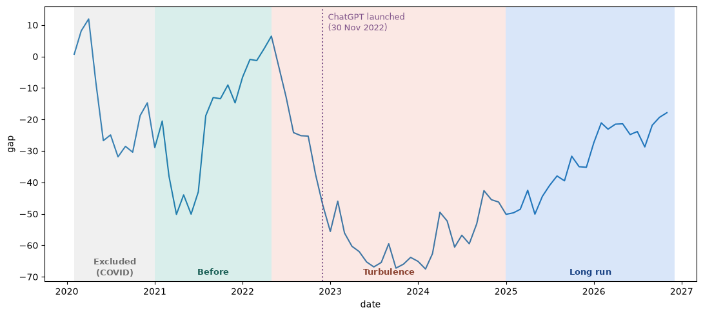
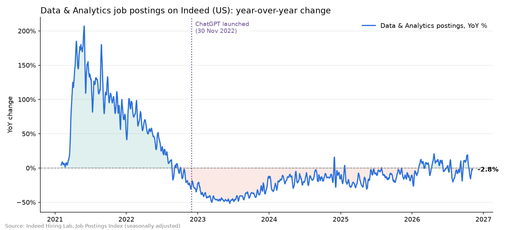

# Did AI Shrink Data Analyst Hiring? A Hypothesis Test on Indeed Job Postings
 
**TL;DR:**
 
Data & Analytics job postings in the US have fallen further behind non-AI jobs since ChatGPT, and the gap has not closed. After the 2022–24 hiring turbulence settled, data roles sit **~11 index points further behind** low-AI-exposure jobs than they did before (Welch's t-test, one-tailed **p = 0.02**). That fits AI playing a lasting role, but the slide began **six months before ChatGPT launched**. AI is likely one contributor, alongside interest-rate hikes and the cooldown after the 2021–22 hiring boom, not the whole story.
 
---
 
## The question
 
Data analyst postings dropped sharply after 2022. The popular explanation is "AI took the jobs." The boring explanation is "the whole job market cooled." This project tests which story the data supports.
 
**Has the Data & Analytics sector fallen further behind non-AI jobs than it was before ChatGPT, even after the market sort of settled?**
 
## Data
 
| | |
|---|---|
| **Source** | [Indeed Hiring Lab, Job Postings Index](https://github.com/hiring-lab/job_postings_tracker) (`job_postings_by_sector_US.csv`) |
| **Measure** | **New postings** index (jobs live 7 days or fewer), seasonally adjusted, 1 Feb 2020 = 100 |
| **Why new postings** | They capture employers' fresh hiring decisions, without old roles that are just hard to fill |
| **Coverage** | US, Feb 2020 – Nov 2026, daily → averaged to **monthly** |
| **AI-exposed group** | Data & Analytics |
| **Low-exposure group** | Average of Logistic Support, Driving, Childcare |
 
## Method
 
**Monthly gap** = Data & Analytics index − low-exposure average. If the economy drags all jobs down equally, the gap stays flat. If something hits only data jobs, the gap widens.
 
| Period | Months | Why |
|---|---|---|
| Excluded | Feb – Dec 2020 | COVID crash and rebound (Childcare postings fell 86% between Feb and Apr 2020) |
| **Before** | Jan 2021 – Apr 2022 (16) | Baseline, before the decline began |
| Turbulence | May 2022 – Dec 2024 (32) | Rate hikes, tech layoffs and the ChatGPT launch overlap. Left out of the test |
| **Long run** | Jan 2025 – Nov 2026 (23) | After the turbulence settled |
 
### Hypotheses
 
(α = 0.05, decided before running the test)
 
- **H₀:** After ChatGPT, the new postings gap between the AI-exposed sector (Data & Analytics) and non-AI-exposed sectors (Logistic Support, Driving, Childcare) is the same in the long run (Jan 2025 – Nov 2026) as before (Jan 2021 – Apr 2022). In other words, AI exposure made no difference.
- **H₁:** After ChatGPT, the AI-exposed sector (Data & Analytics) has fallen further behind non-AI-exposed sectors in new postings in the long run (Jan 2025 – Nov 2026) than before (Jan 2021 – Apr 2022). In other words, AI exposure is associated with fewer new postings.
**Test:** Welch's two-sample t-test (independent groups, unequal sizes and variances), one-tailed.
 

 
## Results
 
| Metric | Value |
|---|---|
| Mean gap, before | **−21.9** |
| Mean gap, long run | **−32.9** |
| Difference | **−11.0 points** |
| t-statistic (df ≈ 22.8) | −2.17 |
| p-value (one-tailed) | **0.020** |
| 95% one-sided CI for the difference | (−∞, **−2.3**) |
 
**Decision: reject H₀.** Data & Analytics is significantly further behind non-AI jobs now than before the decline. We can be 95% confident the extra shortfall is at least 2.3 points.
 
## What this means (for a product or hiring manager)
 
- **The drop in data roles isn't just the economy.** Jobs that AI can't do have recovered more strongly than data jobs.
- **It's a lasting shift, not only a dip.** The gap bottomed out at about −68 in late 2023. It has recovered to around −18 but is still below where it was in 2021–22.
- **AI is probably part of it, but not all of it.** The decline started in mid-2022, before ChatGPT existed. That lines up with interest-rate hikes, tech-sector layoffs and the cooldown after the 2021–22 mass-hiring boom. The result is consistent with AI adding to that pressure and keeping data roles from fully recovering.
- **We don't know which roles were hit.** The test covers the whole sector, so it can't say whether entry-level roles were affected more than senior ones.
- **For data professionals:** demand hasn't disappeared, but the bar has moved. Industry reports show a rising share of data postings asking for AI skills.
## Limitations
 
- **Months aren't independent.** Each month's gap is close to the last one, which makes the p-value look stronger than it is. Treat this as **moderate** evidence.
- **The groups weren't moving in parallel.** The gap was already moving before ChatGPT, so the core difference-in-differences assumption doesn't fully hold.
- **Other tech-specific factors** (2022–23 layoffs, higher funding costs for tech firms) can't be separated from AI with this data.
- **No breakdown by seniority.** The index covers the whole sector, so the test can't tell whether entry-level, mid-level or senior postings fell more. A common claim is that AI hits junior roles hardest, and this analysis neither confirms nor rules that out.
- **Coverage:** only Indeed postings and only the US. The index shows relative change, not job counts. Nov 2026 is a partial month.
- **The long-run gap is still trending upward**, so it may keep closing.
## Next steps
 
- **Placebo test:** rerun the test with a fake launch date (e.g. June 2022). If that also comes out "significant", the result reflects the 2022 slowdown rather than ChatGPT.
- **Effect size** (Cohen's d) alongside the p-value
- **Robustness:** repeat with *total* postings and with other low-exposure sectors
- Add **Software Development** as a second AI-exposed sector
- **Seniority split:** use posting-level data (e.g. LinkedIn scrapes with job titles) to test whether entry-level data roles fell more than senior ones
## Context chart
 
Year-over-year change in Data & Analytics postings (total postings):
 

 
---
 
*Built as a self-directed learning project in statistical inference. Data © Indeed Hiring Lab, used under CC BY 4.0.*
 
